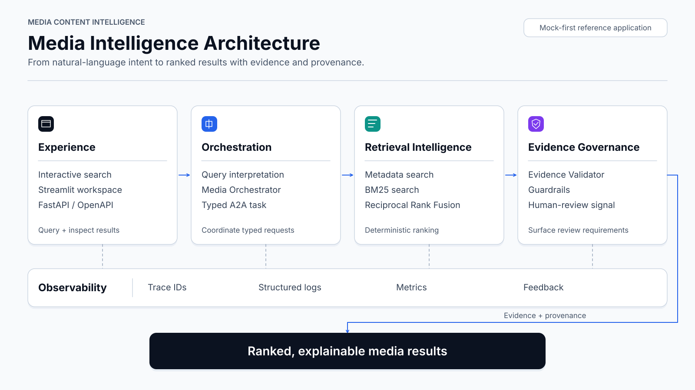
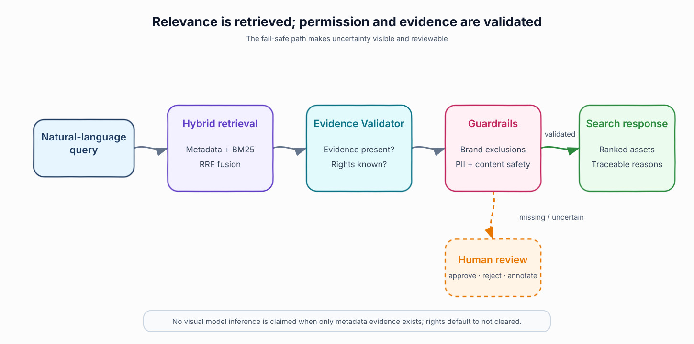

# Media Content Intelligence

Media Content Intelligence (MCI) is a runnable, mock-first reference
application for explainable media search. It accepts a natural-language query,
retrieves matching local media, fuses deterministic rankings, validates the
available evidence, and returns traceable results through FastAPI and a
Streamlit interface.

> **Current boundary:** this public repository contains the complete code
> required to run the application and reproduce inference over media supplied
> by the user. It intentionally excludes datasets, pretrained models, download
> tooling, research pipelines, and the author's extended private
> implementation. It does not yet run production multimodal inference.

[Project layout](docs/project-layout.md) ·
[Dataset contract](docs/datasets.md) ·
[Architecture](docs/architecture.md) ·
[Security](docs/security.md) ·
[Evaluation](docs/evaluation.md)

## What the public application demonstrates

- **Natural-language discovery:** searches local video titles, descriptions,
  dataset labels, annotations, and provenance.
- **Deterministic ranking:** combines metadata and BM25-style retrieval using
  Reciprocal Rank Fusion, making repeated runs reproducible.
- **Agent orchestration:** a Media Orchestrator prepares and dispatches the
  search; an Evidence Validator reports which requested conditions are
  supported and whether human review is required.
- **Governed output:** missing visual or rights evidence is never converted
  into a positive assertion.
- **Operational interfaces:** health checks, Prometheus metrics, trace IDs,
  feedback capture, video serving, and generated OpenAPI documentation.

## How a query becomes a governed result



[Editable Excalidraw source](docs/diagrams/media-intelligence-workflow.excalidraw)

The public runtime discovers media under the ignored local `data/` directory
and builds an in-memory catalog. The query is rewritten, augmented with a HyDE
description, dispatched to deterministic retrieval tools, fused, and converted
into ranked candidates. The interface is deliberately replaceable: production
vision-language models, persistent vector stores, and richer annotations can
be integrated without changing the public API contract.

## Search, validation, and review



[Editable Excalidraw source](docs/diagrams/search-governance-flow.excalidraw)

MCI uses two operative roles:

1. **Media Orchestrator** — interprets the query, generates search variants,
   calls the registered retrieval tools, fuses rankings, and assembles the
   response.
2. **Evidence Validator** — compares each candidate's annotations with the
   requested talent, actions, brands, exclusions, and rights conditions.

The agents are deterministic Python orchestration components in this public
build. They do not call an unconstrained external model or take autonomous
side effects. Only `vector_search`, `bm25_search`, and `rrf_fusion` are
registered as public tools.

## Product demonstrations

Demonstration videos are intended to be distributed as GitHub Release assets,
not committed to source history. Release publication is pending; this README
does not advertise placeholder links. Restricted dataset videos and
pretrained model artifacts will never be included in Git or Release assets.

## Run locally

### 1. Install

```bash
python -m venv .venv
source .venv/bin/activate
pip install -r requirements.txt
```

### 2. Add your own smoke media

Place one or more short videos in an ignored local directory such as
`data/raw/smoke/`. Common video extensions including MP4, WebM, MOV, MKV, and
AVI are discovered automatically. Descriptive filenames improve the minimal
metadata search; richer annotations can be supplied through the catalog
integration described in [docs/datasets.md](docs/datasets.md).

No dataset or pretrained model is downloaded by this public repository.

### 3. Start the API

> **API availability:** the API currently runs on localhost only and will be
> externally exposed soon. No public production endpoint is available yet.

```bash
uvicorn app.main:app --reload
```

- Local API: <http://localhost:8000>
- Local interactive documentation: <http://localhost:8000/docs>
- Local metrics: <http://localhost:8000/metrics>

These localhost interfaces are for development; the API will be externally
exposed soon with authentication, deployment hardening, and access controls.

### 4. Start the interface

> **API dependency:** the Streamlit application currently calls the localhost
> API, which will be externally exposed soon.

```bash
streamlit run frontend/app.py
```

Open the local interface at <http://localhost:8501>. It expects the development
API at `http://localhost:8000`; that API will be externally exposed soon.

### 5. Search through the API

> **API availability:** this example calls the localhost development API. The
> same API will be externally exposed soon after the production access layer is
> available.

```bash
curl -X POST http://localhost:8000/search \
  -H "Content-Type: application/json" \
  -d '{"query": "coffee commercials", "max_results": 5}'
```

The response contains the original, rewritten, and HyDE queries; ranked local
assets; annotations and provenance; evidence-validation results; a trace ID;
and processing latency.

## Public API surface

> **API availability:** every endpoint below currently belongs to the localhost
> development service and will be externally exposed soon. Production exposure
> will add authentication and an explicit access policy.

| Endpoint | Purpose | Output |
|---|---|---|
| `GET /` | Service identity | Name, version, and runtime status |
| `GET /health`, `/health/ready`, `/health/live` | Runtime health | Structured health response |
| `POST /search` | Media discovery | Ranked candidates, validation, trace ID, and latency |
| `GET /search/suggestions` | Query assistance | Suggested search phrases |
| `GET /videos/{video_id}` | Local media delivery | The exact catalogued local asset |
| `POST /feedback` | Review signal | In-memory acknowledgement |
| `GET /metrics` | Observability | Prometheus exposition |

Every HTTP response receives an `X-Trace-ID` header.

## Entry points and exits

| Entry point | Command | Successful exit |
|---|---|---|
| FastAPI service | `uvicorn app.main:app --reload` | Local JSON API, OpenAPI, and metrics; external exposure is coming soon |
| Streamlit UI | `streamlit run frontend/app.py` | Local interface backed by the localhost API; the API will be externally exposed soon |
| Docker stack | `docker compose up --build` | API container with local ignored data/log mounts |
| Health probe | `python scripts/healthcheck.py` | Exit `0` when the localhost API is healthy; external API exposure is coming soon |
| Test suite | `pytest` | Exit `0` when runtime and documentation contracts pass |
| Publication check | `python scripts/check_publish_safety.py` | Exit `0` only when the tracked surface contains no private/data/model artifacts |

## Public versus local-only code

Only the inference application, its minimal UI, tests, diagrams, and
documentation are tracked. The author's broader research implementation stays
in the local working tree and is protected by both `.gitignore` and the
publication-safety check. In particular, `CLAUDE.md`, acquisition scripts,
datasets, model artifacts, experimental components, private services, and
evaluation pipelines are not downloadable from GitHub.

Because ignored files remain available locally, the author can continue
research and development without exposing that implementation. A fresh clone
contains only the reproducible public runtime described here.

## Project structure

```text
Media-Content-Intelligence/
├── app/              FastAPI assembly, settings, dependencies, schemas
├── api/routes/       Health, search, video, and feedback endpoints
├── agents/           Public orchestrator, validator, state, A2A boundary
├── tools/            Deterministic retrieval tools and registry
├── services/         Query rewriting and HyDE generation
├── storage/          Local media catalog
├── security/         Input and output guards
├── observability/    Structured logging and Prometheus metrics
├── frontend/         Streamlit application
├── scripts/          Health and publication-safety checks
├── docs/             Architecture, diagrams, datasets, security, evaluation
└── tests/            Focused public-runtime contract tests
```

## Test and publish safely

```bash
pytest
python scripts/check_publish_safety.py
```

The versioned pre-push hook rejects tracked datasets, media, archives, model
weights, checkpoints, embeddings, local-only implementation paths, and files
larger than 10 MiB. Enable it in a fresh clone with:

```bash
git config core.hooksPath .githooks
```

## Author and contribution

**Prosenjit Banerjee** — <prosenjit.banerjee@gmail.com>

Principal design, data-science architecture, retrieval strategy, agent
orchestration, evidence-governance design, dataset research, implementation,
testing, and documentation.

## License

MIT
